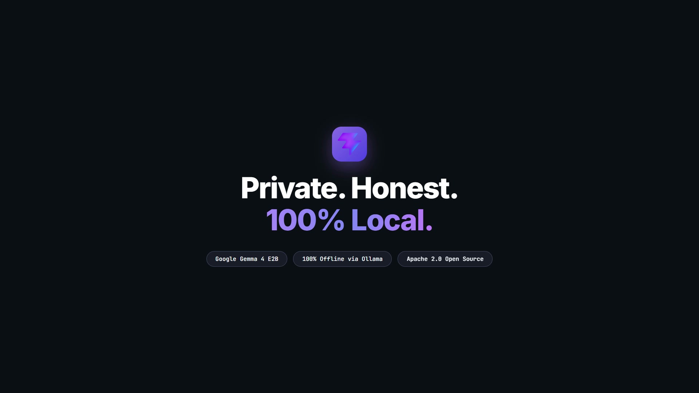
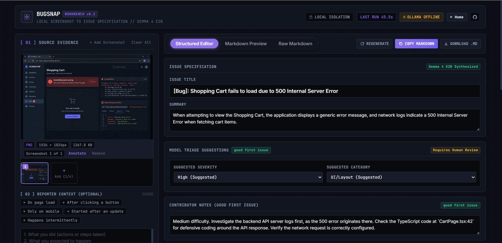

<div align="center">

<!-- BugSnap AI Banner -->


<!-- Typing SVG Tagline -->
<a href="https://github.com/Bunny1089/BUGSNAP">
  
</a>

<p align="center">
  <strong>Local screenshot-to-GitHub-issue generator powered by Google's open-weight Gemma 4 E2B vision model.</strong><br>
  Extracts concrete visual evidence, hypothesizes root causes, warns against secret leaks, and drafts complete GitHub issues—100% privately on your machine.
</p>

<!-- Badges -->
<p align="center">
  
  
  
  
  
  
  
  
  
  
</p>

</div>

---

## 🏆 Built For

BugSnap AI was crafted as an open-source contribution for **Hacktoberfest Hack Day Pune x GDG on Campus VU**.

| Field | Details |
| :--- | :--- |
| **Event** | **Hacktoberfest Hack Day Pune x GDG on Campus VU** |
| **Target Tracks** | 🥇 **Best Open-Source AI Project**<br>💎 **Best Use of Gemma 4** |
| **Core Model** | **Google Gemma 4 E2B** (`gemma4:e2b` via local Ollama) |
| **Inference Location** | **100% On-Device / Localhost** (Zero cloud calls or external telemetry) |
| **Open Source License** | **[Apache 2.0](LICENSE)** |

---

## ⚡ Quick Snapshot

| Attribute | Specification |
| :--- | :--- |
| **Vision Model** | Google's open-weight `gemma4:e2b` (Multimodal vision + language, `Q4_K_M` ~4.6 GB) |
| **Inference Engine** | Local [Ollama](https://ollama.com) daemon at `http://127.0.0.1:11434` |
| **Cloud AI API Calls** | **Exactly 0** — Completely network-independent and offline-ready |
| **Supported Inputs** | Single or multi-screenshot batches (up to 4 images, PNG / JPEG / WebP, max 10 MB each, clipboard paste `Ctrl+V`) |
| **Generated Output** | Structured bug schema, verifiable visible evidence, speculative root causes, fix hints, sensitive-data warnings, and full GitHub-flavored Markdown |
| **Automated Testing** | **21 unit & regression tests** (`pytest` / `pytest-asyncio`), 100% passing |
| **Production Build** | Clean Vite production bundle (`npm run build`) |

---

## 🎬 Video Demo & Launch Showcase

### 🚀 20-Second Product Launch Video

[](brag-output/brag.mp4)

> 🎥 **[Watch the 20-Second Launch Film (MP4)](brag-output/brag.mp4)**  
> *Crafted with [**Brag**](https://github.com/latent-spaces/brag) by [Latent Spaces](https://github.com/latent-spaces) & [Hyperframes](https://hyperframes.heygen.com). Special thanks to the [@latent-spaces/brag](https://github.com/latent-spaces/brag) team for the automated launch video engine!*

---

### 📹 Full Interactive Walkthrough

[](https://youtu.be/aR8upy0Y5qw)

> 📹 **[Watch the Complete Walkthrough Video on YouTube](https://youtu.be/aR8upy0Y5qw)**  
> *Shows live screenshot paste, multi-image sequencing, on-device Gemma 4 vision inference, sensitive key detection, canvas annotation, and Markdown export.*

---

## 💡 The Problem & Why BugSnap AI

### The Reality of Software Bug Reports
Filing and triaging bug reports is one of the biggest productivity sinks in software engineering:
- **Missing Reproduction Steps:** Reporters say *"it's broken"* without providing navigation steps, environment versions, or error codes.
- **Accidental Secret Leaks:** Developers screenshot settings pages, terminals, or network tabs, accidentally exposing production API keys, Bearer tokens, or passwords.
- **Hallucinated "Fixes":** Generic AI tools often hallucinate non-existent line numbers, fake API routes, or unverified facts.
- **Cloud Privacy Risks:** Cloud-hosted AI services upload your proprietary application screens, database names, and internal URLs to remote third-party servers.

### Typical Bug Report vs. BugSnap AI

| Challenge | Typical Bug Report | BugSnap AI with Gemma 4 E2B |
| :--- | :--- | :--- |
| **Reproduction Details** | *"Checkout doesn't work"* (no steps) | Extracts exact visible buttons, banners, and generates step-by-step reproduction instructions. |
| **Evidence vs Guesswork** | Mixed up opinions with observed facts | **Strict Divergence Grid:** Verified on-screen facts are hard-separated from unverified hypotheses. |
| **Confidentiality & PII** | Secrets posted publicly to GitHub | **Sensitive Data Detector:** Alerts reporter to redact visible API keys, passwords, or personal data. |
| **Privacy & Security** | Screenshots uploaded to cloud AI servers | **100% Local:** Everything executes on localhost via Ollama; RAM-only image processing. |
| **Maintainer Workload** | Back-and-forth asking for browser versions | Auto-fills browser, platform, and screen resolution with follow-up clarifying questions. |
| **First-Time Contributors** | Complex issues discourage beginners | **Beginner Mode:** Synthesizes `good first issue` notes, difficulty rating, and verification tips. |

---

## 🖼️ Application Showcase

<div align="center">

### 1. Modern Landing Page

*High-converting dark aesthetic hero featuring real-time health indicator, feature highlights, and 1-click launcher.*

### 2. Developer Studio & Multi-Image Ingestion

*Two-pane studio with drag-and-drop viewfinder, multi-image thumbnail strip, 7 benchmark presets, and quick-fill context chips.*

### 3. Step-by-Step Local Inference

*Real-time multi-stage inference progress tracker monitoring local image buffer validation, Ollama vision query, and schema synthesis.*

### 4. Interactive Structured Editor & Fix Hints

*Evidence vs. Hypotheses divergence grid, suggested severity/category triage, and editable suggested fix hints card.*

### 5. Sensitive Data Redaction Alert

*Automated security guardrail warning reporters before publishing exposed API keys, access tokens, or credentials.*

### 6. Built-in Canvas Annotation Studio

*In-browser plain canvas editor supporting red focus boxes, directional arrows, and pixelated redaction blurs before saving.*

### 7. Triple-Mode Markdown Switcher

*Seamless continuous tab switcher allowing maintainers to toggle between the structured form, live sanitized preview, and raw Markdown.*

</div>

---

## ✨ Features (Verified in Codebase)

All features listed below are implemented and verified directly in the repository codebase:

| Feature | Description | Implementation Source |
| :--- | :--- | :--- |
| **Landing Page** | High-performance hero with animated glassmorphic cards and instant workbench launch button. | `frontend/src/components/Landing.jsx` |
| **ContinuousTabs Switcher** | Frictionless tab bar toggling between **Structured Editor**, **Live Markdown Preview**, and **Raw Editor**. | `frontend/src/components/ContinuousTabs.jsx` |
| **Local Draft History & Pinning** | LocalStorage history storing up to 15 drafts with search filtering and persistent pin-to-top toggles. | `frontend/src/components/ShufflePinnedList.jsx` |
| **7 Benchmark Presets** | 1-click sample benchmarks covering 404 routes, JS crashes, UI collisions, exposed secrets, CI failures, console errors, and form validation bugs. | `frontend/src/App.jsx` (`SAMPLE_PRESETS`) |
| **Quick-Fill Context Chips** | 5 quick-append chips (*On page load*, *After clicking a button*, *Only on mobile*, *Started after an update*, *Happens intermittently*) that append narrative directly to reporter context. | `frontend/src/App.jsx` (`CONTEXT_QUICK_CHIPS`) |
| **Character Counter & Tip** | Live character limit meter (`0/500`) with hard cutoff and context-specific AI prompt guidance. | `frontend/src/App.jsx` |
| **Beginner Mode (Good First Issue)** | Toggle prompting Gemma 4 to assess difficulty (Easy/Medium), suggest files to explore, and explain how to verify a fix. | `backend/analyzer.py`, `frontend/src/App.jsx` |
| **Sensitive-Data Warning** | Proactively identifies visible tokens, passwords, and API keys; displays an alert banner warning reporters to redact before posting. | `backend/analyzer.py`, `frontend/src/App.jsx` |
| **Suggested Fix Hints** | Suggests up to 3 short, speculative fix guesses clearly labeled as unverified in both UI and Markdown. | `backend/models.py`, `backend/analyzer.py`, `frontend/src/App.jsx` |
| **Self-Healing JSON Retry** | Automated single-retry mechanism with schema re-prompting if the local vision model returns malformed JSON. | `backend/analyzer.py` (`analyze_screenshot_with_ollama`) |
| **Multi-Image Sequencing** | Ingests up to 4 screenshots, processes each sequentially showing `Analyzing N of M`, and merges drafts using deterministic rules. | `frontend/src/App.jsx` (`handleAnalyze`) |
| **Canvas Annotation Studio** | Interactive modal canvas equipped with rectangle bounding boxes, directional arrows, and pixelated area blurs. | `frontend/src/App.jsx` (`handleSaveAnnotation`) |
| **Inference Progress Tracker** | Real-time multi-step progress bar showing image ingestion, Ollama query, and schema synthesis with stopwatch timer. | `frontend/src/App.jsx` (`inference-progress-box`) |
| **Environment Auto-Detection** | 1-click auto-fill detecting user agent, operating system platform, and screen resolution. | `frontend/src/App.jsx` (`resolveEnvironment`) |
| **Multi-Format Export** | Instant 1-click clipboard copy (`COPY MARKDOWN`) and file download (`DOWNLOAD .MD` and annotated PNG export). | `frontend/src/App.jsx` |
| **Clipboard Paste (`Ctrl+V`)** | Global window paste listener allowing instant capture from OS Snipping Tool or screenshot utilities. | `frontend/src/App.jsx` (`handlePaste`) |
| **Health Heartbeat Polling** | Silent 10-second polling interval querying `/health` with visual status indicators for Ollama and `gemma4:e2b`. | `frontend/src/App.jsx` (`checkHealth`) |
| **Offline Isolation Badge** | Real-time online/offline event detection displaying `LOCAL ISOLATION` or `OFFLINE — STILL WORKING`. | `frontend/src/App.jsx` (`isOnline`) |

---

## 🧠 Why Google Gemma 4 E2B?

BugSnap AI is powered by **Gemma 4 E2B**, Google's open-weight multimodal model designed for efficient on-device intelligence.

### Why Gemma 4 E2B is the Ideal Choice:
1. **Multimodal Visual Comprehension:** Gemma 4 E2B can read small interface typography, understand layout hierarchy, inspect stack trace errors, and identify UI collisions directly from image pixels.
2. **Laptop-Class Local Footprint:** At ~4.6 GB quantized (`Q4_K_M`), Gemma 4 E2B fits comfortably into consumer laptops with 16 GB RAM and entry-level GPUs like the NVIDIA RTX 3050 (4 GB / 6 GB VRAM).
3. **Zero Data Egress:** Because the model runs entirely through Ollama on `127.0.0.1`, sensitive internal software screenshots never touch third-party servers.
4. **Structured JSON Output:** Gemma 4 reliably follows structured JSON instructions, allowing BugSnap AI to enforce strict schema validation via Pydantic.

### Hardware Performance Benchmarks
- **Test Machine:** Intel Core i5 / i7 + NVIDIA RTX 3050 Laptop GPU (16 GB RAM)
- **Model Size:** 4.6 GB (`Q4_K_M`)
- **Cold-Start Latency:** ~25–35 seconds (initial weight mapping from NVMe storage into VRAM/RAM)
- **Warm Inference Latency:** **14–19 seconds** per screenshot
- **Memory Footprint:** In-memory Pillow resizing bounds all images to a maximum of 1024×1024 px, preventing CUDA out-of-memory errors while preserving sharp text readability.

---

## ⚙️ How It Works: Architecture & Pipeline

```
┌────────────────────────────────────────────────────────────────────────┐
│                        USER BROWSER CLIENT                             │
│   • Drag & Drop or Ctrl+V Screenshot (PNG, JPEG, WebP, max 4 images)   │
│   • Reporter Context Narrative (Quick-Fill Chips, 500 Char Counter)    │
│   • Canvas Annotation & Pixelate Blur Studio                           │
└───────────────────────────────────┬────────────────────────────────────┘
                                    │
                         POST /analyze (multipart)
                                    │
                                    ▼
┌────────────────────────────────────────────────────────────────────────┐
│                       FASTAPI BACKEND (:8000)                          │
│                                                                        │
│  [ Step 1: In-Memory Validation (Pillow) ]                             │
│    • Format verification (PNG, JPEG, WebP)                             │
│    • 10 MB payload limit check                                         │
│    • RAM-only processing (Zero disk writes)                            │
│    • Thumbnail downscale to max 1024px (protects GPU VRAM)             │
│    • Base64 encoding for Ollama vision API                             │
│                                                                        │
│  [ Step 2: Prompt Construction ]                                       │
│    • Anti-hallucination rules (unobserved facts -> "Unknown")          │
│    • Separation of direct evidence vs. root cause hypotheses           │
│    • Sensitive data detection instructions                             │
│    • Beginner mode assessment (if toggled)                             │
│    • Suggested fix hints request (capped at 3)                         │
└───────────────────────────────────┬────────────────────────────────────┘
                                    │
                     POST /api/chat (JSON Base64)
                                    │
                                    ▼
┌────────────────────────────────────────────────────────────────────────┐
│                    LOCAL OLLAMA DAEMON (:11434)                        │
│                                                                        │
│   • Google Gemma 4 E2B Vision Model (`gemma4:e2b`)                     │
│   • Fully local GPU/CPU inference on localhost                         │
│   • Structured JSON mode generation                                    │
└───────────────────────────────────┬────────────────────────────────────┘
                                    │
                          Raw Model JSON Output
                                    │
                                    ▼
┌────────────────────────────────────────────────────────────────────────┐
│                     BACKEND RESPONSE PROCESSOR                         │
│                                                                        │
│  [ Step 3: Self-Healing Validation & Fallback ]                        │
│    • Pydantic schema validation (`BugDraft`)                           │
│    • If JSON malformed: 1-time automated retry with prompt reminder    │
│    • Sensitive data sanitization (strips raw secret tokens >= 20 char) │
│    • Trims fix hints to max 3 items                                    │
│    • Formats polished GitHub-flavored Markdown                         │
└───────────────────────────────────┬────────────────────────────────────┘
                                    │
                        JSON { status: "success", draft }
                                    │
                                    ▼
┌────────────────────────────────────────────────────────────────────────┐
│                      FRONTEND WORKBENCH (:5173)                        │
│   • Multi-image draft merging                                          │
│   • Interactive Structured Editor (Editable items, tags)               │
│   • Suggested fix hints card (unverified)                              │
│   • Live Markdown Preview (sanitized via DOMPurify + marked)           │
│   • 1-Click Copy Markdown & Download .md / PNG                         │
└────────────────────────────────────────────────────────────────────────┘
```

---

## 🔒 Privacy & Anti-Hallucination Design

BugSnap AI is engineered with defense-in-depth safety and privacy guardrails:

1. **In-Memory RAM Processing:** Screenshots are processed via Python's `io.BytesIO`. Images are never saved to temporary disk files, database tables, or cloud buckets.
2. **Strict Separation of Evidence vs. Hypotheses:** Visual facts (e.g. `HTTP 404 banner`, `TypeError: items is undefined`) are rendered under **Visible Evidence**. Potential causes (e.g. `Database route misconfigured`) are strictly isolated under **Hypotheses (Unverified Possible Causes)**.
3. **No Fabricated Reproduction Steps:** If reproduction steps cannot be established with certainty from the visual evidence, BugSnap outputs `Unknown - exact reproduction steps not supplied` and moves clarifying inquiries to `Missing Information`.
4. **Sensitive Data Sanitization:** If Gemma detects visible API keys or credentials, BugSnap alerts the user with a warning badge. The backend parser drops raw string tokens exceeding 20 continuous characters to ensure secrets are never echoed in the generated Markdown draft.

---

## 🛠 Tech Stack Details

### Frontend
- **Framework:** [React 19.3](https://react.dev/) + [Vite 8.3](https://vitejs.dev/)
- **Styling:** [Tailwind CSS v4](https://tailwindcss.com/) + Custom Dark Graphite Theme Tokens
- **Icons & Motion:** [Lucide React](https://lucide.dev/), [React Icons](https://react-icons.github.io/react-icons/), [Motion](https://motion.dev/)
- **Markdown & Security:** [Marked 18](https://marked.js.org/) + [DOMPurify 3](https://github.com/cure53/DOMPurify)
- **Linter:** [Oxlint](https://oxc.rs/)

### Backend
- **Framework:** [FastAPI](https://fastapi.tiangolo.com/) + [Uvicorn](https://www.uvicorn.org/)
- **Validation & Schemas:** [Pydantic v2](https://docs.pydantic.dev/)
- **Image Processing:** [Pillow 10+](https://pillow.readthedocs.io/)
- **Async HTTP Client:** [HTTPX](https://www.python-httpx.org/)
- **Testing:** [pytest 8+](https://docs.pytest.org/) + [pytest-asyncio](https://pytest-asyncio.readthedocs.io/)

---

## 📂 Repository Layout

```
BUGSNAP/
├── .gitignore
├── BUGSNAP_HACKATHON_GUARDRAILS.md # Official hackathon compliance guardrails
├── CONTRIBUTING.md                 # Contribution guide & good-first-issue list
├── LICENSE                         # Apache 2.0 Open Source License
├── README.md                       # Comprehensive documentation
├── docs/
│   ├── PROJECT_AUDIT.md            # Architecture audit & verification notes
│   ├── demo-script.md              # 60–90 second hackathon pitch video script
│   └── images/                     # Showcase screenshots & demo media
├── backend/
│   ├── app.py                      # FastAPI application (/health, /analyze)
│   ├── analyzer.py                 # Pillow validation, prompt builder & Ollama client
│   ├── models.py                   # Pydantic schemas (BugDraft, AnalyzeResponse)
│   ├── make_samples.py             # Benchmark image generator (samples 1–7)
│   ├── requirements.txt            # Python dependencies
│   └── tests/
│       ├── __init__.py
│       ├── test_api.py             # Root & health endpoint tests (4 tests)
│       └── test_analyze.py         # Image validation, mock, & regression tests (17 tests)
└── frontend/
    ├── index.html                  # HTML entry point
    ├── package.json                # React 19, Vite 8, Tailwind v4 dependencies
    ├── vite.config.js              # Proxy configuration to :8000
    ├── public/
    │   └── samples/                # Benchmark screenshots (samples 1–7)
    └── src/
        ├── App.css                 # Dark graphite theme & component styling
        ├── App.jsx                 # Main application & interactive workbench
        ├── index.css               # Design tokens & typography layer
        ├── main.jsx                # React root mount
        ├── assets/
        └── components/
            ├── Alert.css           # Alert notification styles
            ├── Alert.jsx           # Accessible alert notification component
            ├── ContinuousTabs.jsx  # Viewport mode switcher (Editor/Preview/Raw)
            ├── Landing.jsx         # High-impact landing page & hero
            └── ShufflePinnedList.jsx # Local draft history manager with pinning
```

---

## 🚀 Quickstart Guide

### 1. Prerequisites
1. **Ollama**: Installed and running locally. Pull the Gemma 4 vision model:
   ```bash
   ollama pull gemma4:e2b
   ```
   Verify Ollama is reachable: `curl http://127.0.0.1:11434/api/tags`.
2. **Python**: Version 3.10 or higher.
3. **Node.js**: Version 18+ with `npm`.

---

### 2. Backend Setup
```bash
# 1. Navigate to backend directory
cd backend

# 2. (Optional) Create and activate virtual environment
python -m venv venv
# Windows: .\venv\Scripts\activate
# Linux/macOS: source venv/bin/activate

# 3. Install dependencies
pip install -r requirements.txt

# 4. Generate benchmark screenshot images (samples 1-7)
python make_samples.py

# 5. Start the FastAPI backend server
uvicorn app:app --port 8000 --reload
```
Verify endpoints:
- **Health check:** [http://127.0.0.1:8000/health](http://127.0.0.1:8000/health)
- **Interactive OpenAPI docs:** [http://127.0.0.1:8000/docs](http://127.0.0.1:8000/docs)

---

### 3. Frontend Setup
```bash
# 1. In a second terminal, navigate to frontend directory
cd frontend

# 2. Install dependencies
npm install

# 3. Start Vite development server
npm run dev
```
Open **[http://localhost:5173](http://localhost:5173)** in your browser.

---

## 🧪 Automated Test Suite

BugSnap AI includes **21 automated unit and regression tests** covering image validation constraints, network failure handling, anti-hallucination guarantees, and markdown synthesis.

Run the test suite from `backend/`:
```bash
cd backend
python -m pytest -v
```

<details>
<summary><strong>🔍 Click to inspect test coverage breakdown</strong></summary>

```
tests\test_analyze.py .................                                  [ 80%]
  • test_analyze_invalid_format (rejects non-image extensions with 400)
  • test_analyze_corrupted_image (rejects invalid PNG headers with 400)
  • test_analyze_too_small_dimensions (rejects sub-10px files with 400)
  • test_analyze_oversized_upload (rejects >10MB files with 413)
  • test_analyze_successful_mocked (end-to-end vision mock pipeline)
  • test_analyze_ollama_unreachable (503 Service Unavailable handling)
  • test_analyze_ollama_timeout (504 Gateway Timeout handling)
  • test_analyze_malformed_model_output_fallback (graceful parsing of non-JSON)
  • test_generate_markdown_formatting (markdown section validation)
  • test_regression_unsupported_reproduction_steps_defaults_to_unknown
  • test_regression_evidence_vs_user_context_separation
  • test_analyze_retry_on_malformed_json_success
  • test_analyze_retry_on_malformed_json_failure
  • test_beginner_mode_prompt_and_schema
  • test_sensitive_data_detection_and_sanitization
  • test_sensitive_data_raw_secret_filtering
  • test_generate_markdown_includes_beginner_notes

tests\test_api.py ....                                                   [100%]
  • test_root_endpoint
  • test_health_endpoint_healthy
  • test_health_endpoint_ollama_offline
  • test_health_endpoint_model_missing
======================== 21 passed in 0.88s ========================
```
</details>

---

## 🛠️ Troubleshooting

| Symptom | Probable Cause | Recommended Action |
| :--- | :--- | :--- |
| **Status: `OLLAMA OFFLINE`** | Ollama daemon is not running on localhost. | Run `ollama serve` in a background terminal. |
| **Status: `MODEL MISSING`** | The `gemma4:e2b` weights have not been pulled. | Run `ollama pull gemma4:e2b`. |
| **Inference Timeout (HTTP 504)** | Cold-start latency exceeded timeout while loading model into VRAM. | Click **Retry Analysis**; subsequent warm calls execute in 14–19 seconds. |
| **Payload Too Large (HTTP 413)** | Screenshot file exceeds 10 MB limit. | Crop the screenshot or use standard PNG/JPEG compression. |
| **CORS / Network Error in Browser** | Backend is offline or running on an unexpected port. | Verify FastAPI is running at `http://127.0.0.1:8000/health`. |

---

## 🎃 Hacktoberfest & Contributing

BugSnap AI is built for the open-source community! We encourage developers to participate in Hacktoberfest by contributing features, presets, tests, and documentation.

Please read our **[CONTRIBUTING.md](CONTRIBUTING.md)** for development guidelines and our pull request process.

### 🌟 Good First Issues for Contributors

| Category | Difficulty | Description | Getting Started Pointer |
| :--- | :---: | :--- | :--- |
| **Export Formats** | `Easy` | Add Jira or Linear markdown export options. | See `handleCopyMarkdown` in `frontend/src/App.jsx`. |
| **Benchmark Presets** | `Easy` | Add new real-world scenario presets (e.g. mobile Safari viewport, 500 error). | Add to `SAMPLE_PRESETS` in `App.jsx` and generate images in `make_samples.py`. |
| **Theme Toggle** | `Medium` | Add a light / dark theme toggle. | Extend CSS variables in `frontend/src/index.css` and `App.css`. |
| **Localization** | `Medium` | Translate landing and workbench UI to Hindi and Marathi. | Extract UI text strings into a translation dictionary. |
| **Test Coverage** | `Easy` | Add additional test scenarios for multi-image sequential edge cases. | Extend `backend/tests/test_analyze.py`. |
| **Accessibility Audit** | `Easy` | Improve ARIA labels and keyboard focus management across the modal canvas. | Audit `frontend/src/App.jsx`. |

---

## 🗺️ Roadmap (Unbuilt Ideas)

The following capabilities are planned for upcoming releases:
- [ ] **1-Click GitHub Issue Creation:** Direct issue creation using a client-side personal access token (PAT) stored only in memory.
- [ ] **Offline Vector Search:** Local RAG memory over past bug drafts to suggest existing duplicate issues.
- [ ] **Export to Jira & Linear:** Pre-formatted ticket templates for enterprise bug trackers.
- [ ] **Multi-Lingual Localization:** Native UI support for Hindi, Marathi, Spanish, and German.
- [ ] **Native Desktop Application:** Standalone desktop bundle using Tauri or Electron.

---

## ⚖️ Hackathon Compliance & AI Disclosure

- **Hackathon Guardrails:** Adheres strictly to all specifications defined in [BUGSNAP_HACKATHON_GUARDRAILS.md](BUGSNAP_HACKATHON_GUARDRAILS.md).
- **Core Model:** Google open-weight `gemma4:e2b` executed exclusively via local Ollama.
- **Assistance Disclosure:** Antigravity IDE was used as an agentic pair programmer for scaffolding, test writing, and refactoring; all runtime inference is 100% on-device.
- **License:** Licensed under the [Apache 2.0 License](LICENSE).

---

## 👨‍💻 Author

<div align="center">

**Kulmeet Singh Chauhan**  
GitHub: [@Bunny1089](https://github.com/Bunny1089)

*Built with passion for Hacktoberfest Hack Day Pune x GDG on Campus VU.*

⭐ **If you find BugSnap AI useful, please star this repository!** ⭐

<!-- Capsule Render Footer -->


</div>
